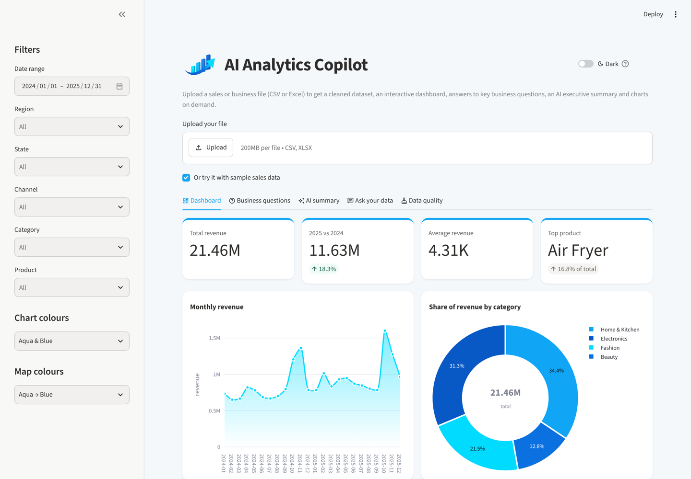
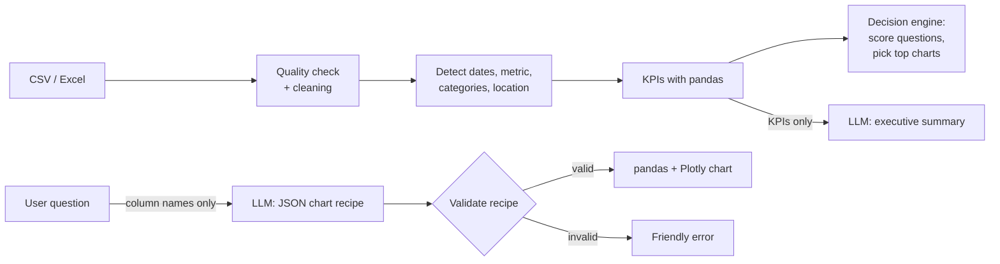

<p align="center">
  
</p>

<h1 align="center">AI Analytics Copilot</h1>

<p align="center">
  <b>Upload any business spreadsheet and get, in seconds, a cleaned dataset, a decision-ready dashboard, an AI-written executive summary, and charts from plain-English questions.</b>
</p>

<p align="center">
  <a href="https://ai-analytics-copilot.streamlit.app"></a>
</p>

<p align="center">
  
  
  
  
  
  
</p>



## Highlights

- **Decision dashboard, not a fixed template.** Scores ~10 business questions against each dataset and leads with the most relevant, each with a one-line answer. For example: *"3 of 16 products declined; the biggest drop is Hair Dryer (−25.6%)."*
- **100% accuracy on a 20-question test set** for the natural-language-to-chart feature, measured over 4 runs (up from 95% in the first version).
- **Private by design.** The AI sees only aggregated KPIs and column names, never raw rows.
- **No AI-generated code is run.** The LLM returns a JSON chart recipe that is validated before pandas and Plotly build the chart.
- **Fast.** Caching cut each interaction from ~3s to under 1s.
- **Works on any business table** (sales, HR, operations), with automatic data cleaning, date detection and India / US / world maps.

## The problem it solves

Analysts often spend hours cleaning an export, building the same charts and writing a summary before they can answer *"How are we doing, and what should we do next?"* This app does that first pass automatically, so the analyst starts from answers instead of a blank sheet.

## Features

| | Feature | What it does |
|---|---|---|
| 🧹 | **Data quality & cleaning** | Finds duplicates, gaps and messy labels (`"electronics "` vs `"Electronics"`), fixes them and logs every change. |
| 🔎 | **Smart detection** | Detects dates (day-first or month-first), the main metric, categories and locations. Creates **Revenue = Quantity × Price** when no revenue column exists. |
| 📊 | **Decision dashboard** | Picks the most relevant charts for the data: growth trend, drivers of change, rising and falling items, concentration risk, seasonality, what moves revenue. Each card shows the question, the answer and the chart. |
| ❓ | **Key business questions** | Deeper analysis tab: seasonality heatmap, Pareto, waterfall, distribution and more. |
| ✨ | **AI executive summary** | Headline, key findings, watch-outs and recommended actions, grounded only in calculated numbers. |
| 💬 | **Ask your data** | *"Top 5 products by revenue in the North region"* returns a chart. Press Enter, keep a history, pin charts to the dashboard. |
| ⬇️ | **Export & themes** | Download the dashboard as an HTML report, filter by date or category, switch light or dark mode. |


## How it works



**Key engineering decisions**
- **Recipe, not code.** The LLM picks the chart type, columns, calculation and filters as JSON. The app checks them against the real schema and an allow-list, so it can't invent columns or run arbitrary code.
- **Grounded AI summary.** The prompt only allows numbers present in the KPIs and blocks invented causes. Users can open *"What the AI sees"* to verify every figure.
- **Explainable chart selection.** Charts appear only when the data supports them. For example, seasonality shows only if some months are 30%+ above average, and a concentration warning only if the top 20% of items bring 60%+. The engine also skips mostly-missing columns and flags incomplete years.

## Evaluation

`eval_charts.py` runs 20 business questions through the same pipeline the app uses. It checks the chart type, columns, calculation and filters, and includes one question that *should* be refused.

| Version | Result |
|---|---|
| First version | 19/20 (95%) |
| After fixes, 4 runs | **20/20 (100%) every run** |

Failures were fixed with **general** rules ("spread" → box plot, "break down" → treemap, "does X affect Y" → scatter) rather than question-specific patches, and the recipe model runs at `temperature=0` for consistent results.

## Run it locally

```bash
git clone https://github.com/Vaibh31/AI-analytics-copilot.git
cd AI-analytics-copilot
python -m venv venv
venv\Scripts\activate            # macOS/Linux: source venv/bin/activate
pip install -r requirements.txt
```

Add a free key from [console.groq.com](https://console.groq.com) to a `.env` file:

```
GROQ_API_KEY=your_key_here
```

```bash
streamlit run app.py
```

Tick **"Try it with sample sales data"** to explore instantly. Run `python eval_charts.py` to reproduce the accuracy test.

## Project structure

```
app.py            Streamlit app: layout, filters, tabs, export
analysis.py       Loading, quality report, cleaning, date parsing, detection, KPIs
decisions.py      Decision engine: scores business questions, picks charts + takeaways
charts.py         Plotly chart builders and colour themes
insights.py       KPI summary + LLM executive summary
chart_query.py    Question → JSON recipe → validation → chart
eval_charts.py    20-question accuracy test
sample_sales.csv  5,000+ sample orders with deliberate data-quality issues
```

## Limitations

- Totals assume the main number makes sense to add up (revenue, units, salary).
- Dates are detected from column names with words like *date, time, day, month* or *period*.
- Chart selection is rule-based, so an unusually named column may be ranked lower than it deserves.
- The 100% score is on the test set that was also used to refine the rules; new phrasings may occasionally fail.

## Credits

India state boundaries: [DataMeet India](https://github.com/datameet/maps) community (CC BY 4.0).

---

Built by **Vaibhavi Tikke** · [LinkedIn](https://www.linkedin.com/in/vaibhavi-tikke-0a3bb4285/)