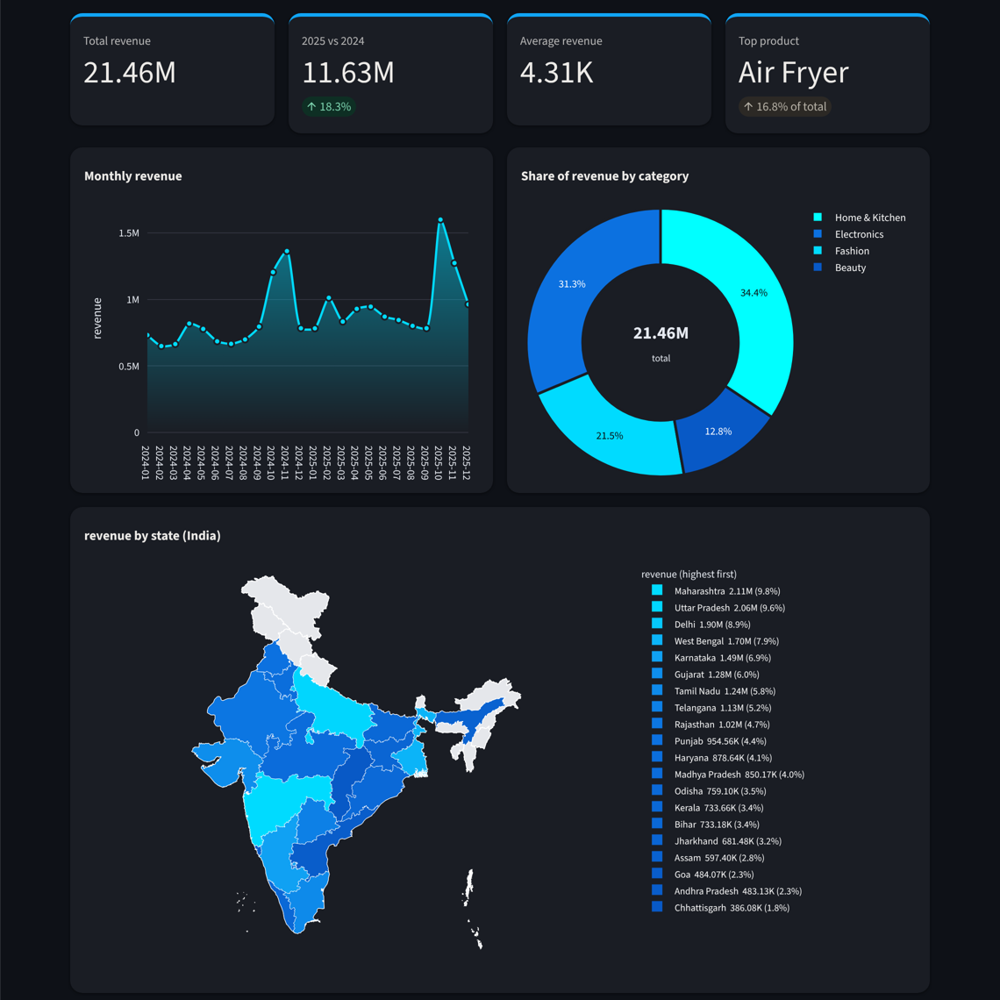
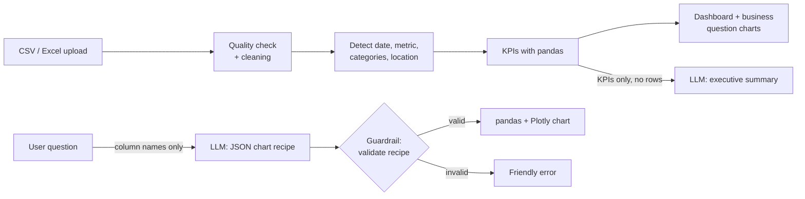

<p align="center">
  
</p>

<h1 align="center">AI Analytics Copilot</h1>

<p align="center">
  <b>Upload a business spreadsheet. Get a cleaned dataset, a KPI dashboard, an AI-written executive summary, and charts from plain-English questions in seconds.</b>
</p>

<p align="center">
  <a href="https://ai-analytics-copilot.streamlit.app"><b>▶ Try the live app</b></a> ·
  Python · Streamlit · Plotly · LangChain · Groq
</p>


---

## The problem

A typical analyst request ("how did sales do this year, and what should we watch?") means hours of cleaning a messy export, building charts and writing a summary for a manager. AI Analytics Copilot does that first pass automatically, so the analyst can start from answers instead of a blank sheet.

## What it does

| Step | What happens |
|---|---|
| **1. Data quality check** | Finds duplicates, missing values and messy text (`"electronics "` vs `"Electronics"`) and shows a before/after report. |
| **2. Automatic cleaning** | Merges inconsistent labels, removes duplicates, drops or fills gaps with a rule that's logged and shown to the user. |
| **3. Smart detection** | Works out the date column, the main metric (revenue, salary, cost…), the categories, and any country or state column for maps. |
| **4. KPI dashboard** | KPI cards, monthly trend, India / US / world map, category share, product treemap, year-over-year waterfall, stacked bars. Filters in the sidebar update everything. |
| **5. Key business questions** | How are we trending? What's seasonal? Who's growing or falling? How concentrated is revenue (Pareto)? Each answered with a chart. |
| **6. AI executive summary** | A headline, key findings, watch-outs and recommended actions, written by an LLM **from the KPIs only**. |
| **7. Ask your data** | Type *"top 5 products by revenue in the North region"* and get the chart. Pin any chart to the dashboard and download the dashboard as an HTML report. |

Works on any table with a number column: sales, HR, operations. Light and dark mode included.



## How it works



### Design choices

- **The AI never sees raw rows.** The summary is written from aggregated KPIs, and the chart feature sees only column names and category labels. Users can open *"What the AI sees"* to check exactly what was sent.
- **The AI writes a recipe, not code.** For *Ask your data*, the LLM returns a small JSON recipe (chart type, columns, calculation, filters). The app checks it against the real columns and an allow-list before pandas and Plotly build the chart. No AI-generated code is ever executed.
- **Grounded summaries.** The prompt only allows numbers that appear in the KPIs, blocks invented causes, and uses a fixed format so the output is predictable.
- **Fast on every click.** Loading and cleaning are cached, and map shapes are trimmed per region, so a filter change takes under a second.

## Evaluation

`eval_charts.py` runs **20 business questions** through the same pipeline the app uses and checks the chart type, columns, calculation and filters, plus one question that *should* be refused (no such data).

| Run | Result |
|---|---|
| First version | 19/20 (95%) |
| After fixes, 4 runs | **20/20 (100%) on every run** |

The first failures were wording issues ("spread" → box plot, "break down" → treemap, "does X affect Y" → scatter). They were fixed with **general** rules rather than question-specific ones, and the recipe model was set to `temperature=0` so the same question always gives the same chart.

```bash
python eval_charts.py
```

## Tech stack

| Area | Tools |
|---|---|
| App & UI | Streamlit |
| Data | pandas |
| Charts & maps | Plotly (choropleth, treemap, waterfall, Pareto, box) |
| AI | LangChain + Groq (`gpt-oss-20b`) |
| Deployment | Streamlit Community Cloud, with the API key stored in Secrets |

## Run it locally

```bash
git clone https://github.com/Vaibh31/AI-analytics-copilot.git
cd AI-analytics-copilot
python -m venv venv
venv\Scripts\activate            # Windows  (macOS/Linux: source venv/bin/activate)
pip install -r requirements.txt
```

Create a `.env` file with a free key from [console.groq.com](https://console.groq.com):

```
GROQ_API_KEY=your_key_here
```

```bash
streamlit run app.py
```

Tick **"Try it with sample sales data"** to explore without uploading anything.

## Project structure

```
app.py            Streamlit app: layout, tabs, filters, dashboard, export
analysis.py       Loading, quality report, cleaning, column + location detection, KPIs
charts.py         All chart builders and the colour themes
insights.py       KPI summary + LLM executive summary
chart_query.py    Question → JSON recipe → validation → chart
eval_charts.py    20-question accuracy test
sample_sales.csv  Sample data (5,000+ orders with deliberate quality issues)
geo/              India state boundaries
```

## Limitations

- Totals assume the main number column makes sense to add up (revenue, units, salary). Ratings or temperatures would be summed too.
- Dates are detected from columns with "date" in the name.
- The 100% score is on a 20-question test set that was also used to refine the rules; new phrasings may still fail occasionally.

## Credits

India state boundaries: [DataMeet India](https://github.com/datameet/maps) community (CC BY 4.0).

---

Built by **Vaishnavi Tikke** · [LinkedIn](https://www.linkedin.com/in/vaishnavi-tikke)
